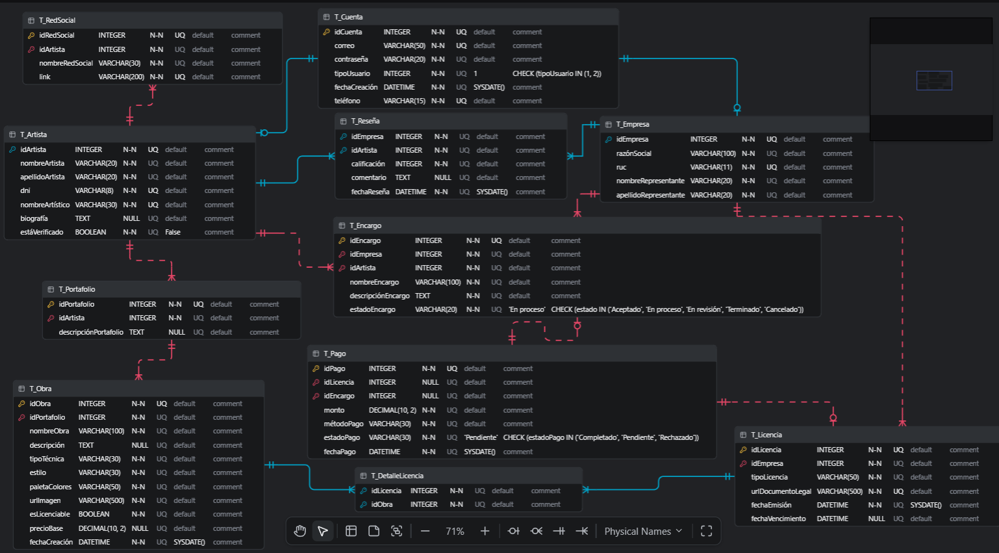

# ✏️ TrazoMatch - Database Design 💻


**TrazoMatch** is a platform that connects artists with companies interested in licensing artworks or requesting custom commissions.

The project includes the entity-relationship design, table creation scripts, sample data, and SQL queries on the MySQL database.

Translations: **English** · [Español](translations/spanish/README-SPA.md)

## 👥 Team

| Member |
| --- |
| Gutierrez Quispe, Joaquín Armando |
| Kobashigawa Ugaz |
| Leon Ojeda, Adrian Alejandro |
| Lopez Polo, Anghel Victoria Claudeth |
| Sedano Barreda, Luis Enrique |

## 📊 Data Model

TrazoMatch uses a MySQL database named `TrazoMatch`. The database distinguishes two types of users: **artists** and **companies**.



## ❗ Main Entities

| Entity | Description |
| --- | --- |
| `T_Cuenta` | Common access data: email, password, phone, creation date, and user type (`1` artist or `2` company).
| `T_Artista` | Personal and artistic information. Shares its identifier with `T_Cuenta`.
| `T_Empresa` | Business name, RUC, and representative. Shares its identifier with `T_Cuenta`.
| `T_RedSocial` | Social profiles associated with an artist.
| `T_Portafolio` | Portfolio belonging to an artist.
| `T_Obra` | Artwork within a portfolio, with technique, style, palette, image, price, and licensing condition.
| `T_Licencia` | License acquired by a company, with validity period and legal document.
| `T_DetalleLicencia` | Many-to-many relationship between licenses and artworks.
| `T_Encargo` | Request made by a company to an artist and its execution status.
| `T_Pago` | Payment associated exclusively with a license or a commission.
| `T_Reseña` | Rating and comment from a company toward an artist.

### Relevant Relationships

- Each `T_Artista` and `T_Empresa` is linked to a `T_Cuenta` through the same identifier.
- An artist can have multiple social networks and a portfolio.
- A portfolio groups artworks and an artwork can be part of multiple licenses.
- A license belongs to a company and relates to artworks through `T_DetalleLicencia`.
- A commission involves a company and an artist.
- A payment corresponds to a license or a commission, never both.
- A company can rate an artist only once; the composite primary key is `(idEmpresa, idArtista)`.

## 🔧 Setup

### Requirements

- MySQL 8 or compatible.
- Visual Studio Code, VS Codium, or another IDE compatible with SQL language that allows cloning repositories.
- SQLTools VS Code Extension (Also works in VS Codium) by Matheus Teixeira or another extension compatible with MySQL.
- MongoDB
- MongoDB for VS Code (Also works in VS Codium) or another extension compatible with MongoDB
- Git 2.0 or Later
- GitHub

- Optional:
  - MySQL Workbench, MySQL Shell, or SQL client.
  - MongoDB Shell or MongoDB Compass.

> [!Important]
> Check [Collaboration.md](https://github.com/krea-labs/TrazoMatch/blob/main/Collaboration.md) in the ```Tools and Languages``` section where you will find the links for the tools, extensions, and the languages to work on the project

### Create and Insert the Database

Run the scripts in the following order from MySQL:

```sql
SOURCE "relational database/database creation/database_tables_creation.sql";
SOURCE "relational database/database creation/additional_constraints.sql";
SOURCE "relational database/data insertion/data_insertion.sql";
```

Paths must be run from the root of the repository or replaced with the corresponding absolute path.

> [!Important]
> The data in [data_insertion.sql](relational%20database/data%20insertion/data_insertion.sql) is demonstration data.

## 📂 Repository Structure

```text
krea-labs/TrazoMatch/
├── assets/
│   ├── logo.jpg
│   └── erd_diagram.png
├── relational database/
│   ├── database creation/
│   │   ├── database_tables_creation.sql
│   │   ├── additional_constraints.sql
│   │   └── drop_database_tables.sql
│   ├── data insertion/
│   │   └── data_insertion.sql
│   └── general queries/
│       └── queries.sql
├── Collaboration.md
├── Diagram.erd
├── Fix_Commit_Protocol.md
└── README.md
```

> [!CAUTION]
> The script [drop_database_tables.sql](relational%20database/database%20creation/drop_database_tables.sql) drops tables and the entire database. It must not be run without prior notice and must not be run when the database has real data.

## 🖱️ Example Query

The included query looks for artworks whose palette contains the colors **rojo** and **azul**, and shows their artist and name:

```sql
SELECT nombreArtístico, T_Obra.nombreObra, T_Obra.paletaColores
FROM T_Artista
INNER JOIN T_Portafolio ON T_Artista.idArtista = T_Portafolio.idArtista
INNER JOIN T_Obra ON T_Portafolio.idPortafolio = T_Obra.idPortafolio
WHERE T_Obra.paletaColores LIKE '%rojo%'
  AND T_Obra.paletaColores LIKE '%azul%';
```

The complete script is available in [queries.sql](relational%20database/general%20queries/queries.sql).

## 🗃️ Additional Resources

- [Project Report](https://docs.google.com/document/d/1CwY6CU1f4eqbhTzVcTMwPEG143-DnSkrk0J3_-Iv_E4/edit?usp=sharing)
- [Project Presentation](https://canva.link/kqo6kmhisfewy4x)
- [Editable Diagram](Diagram.erd)
- [Collaboration Guide](Collaboration.md)