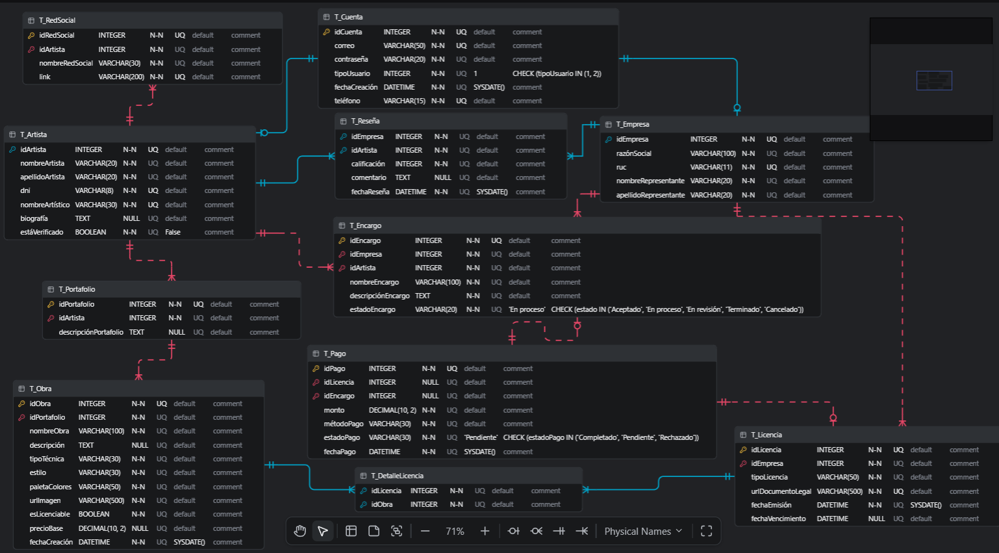

# ✏️ TrazoMatch - Diseño de Base de Datos 💻 


**TrazoMatch** es una plataforma que conecta a artistas con empresas interesadas en licenciar obras o solicitar encargos personalizados.

El proyecto incluye el diseño entidad-relación, los scripts de creación de tablas, datos de ejemplo y consultas SQL sobre la base de datos en MySQL.

Traducciones: [English](../../README.md) · **Español**

## 👥 Equipo

| Integrante |
| --- |
| Gutierrez Quispe, Joaquín Armando |
| Kobashigawa Ugaz |
| Leon Ojeda, Adrian Alejandro |
| Lopez Polo, Anghel Victoria Claudeth |
| Sedano Barreda, Luis Enrique |

## 📊 Modelo de datos

TrazoMatch utiliza una base de datos MySQL llamada `TrazoMatch`. La base distingue dos tipos de usuarios: **artistas** y **empresas**.



## ❗ Entidades principales

| Entidad | Descripción |
| --- | --- |
| `T_Cuenta` | Datos comunes de acceso: correo, contraseña, teléfono, fecha de creación y tipo de usuario (`1` artista o `2` empresa). |
| `T_Artista` | Información personal y artística. Comparte su identificador con `T_Cuenta`. |
| `T_Empresa` | Razón social, RUC y representante. Comparte su identificador con `T_Cuenta`. |
| `T_RedSocial` | Perfiles sociales asociados a un artista. |
| `T_Portafolio` | Portafolio perteneciente a un artista. |
| `T_Obra` | Obra dentro de un portafolio, con técnica, estilo, paleta, imagen, precio y condición de licencia. |
| `T_Licencia` | Licencia adquirida por una empresa, con vigencia y documento legal. |
| `T_DetalleLicencia` | Relación muchos a muchos entre licencias y obras. |
| `T_Encargo` | Solicitud realizada por una empresa a un artista y su estado de ejecución. |
| `T_Pago` | Pago asociado exclusivamente a una licencia o a un encargo. |
| `T_Reseña` | Calificación y comentario de una empresa hacia un artista. |

### Relaciones relevantes

- Cada `T_Artista` y `T_Empresa` está vinculado a una `T_Cuenta` mediante el mismo identificador.
- Un artista puede tener varias redes sociales y un portafolio.
- Un portafolio agrupa obras y una obra puede formar parte de varias licencias.
- Una licencia pertenece a una empresa y se relaciona con obras mediante `T_DetalleLicencia`.
- Un encargo involucra a una empresa y a un artista.
- Un pago corresponde a una licencia o a un encargo, nunca a ambos.
- Una empresa puede calificar a un artista una sola vez; la clave primaria compuesta es `(idEmpresa, idArtista)`.

## 🔧 Configuración

### Requisitos

- MySQL 8 o compatible
- MySQL Workbench, MySQL Shell o cliente SQL
- Visual Studio Code, VS Codium u Otro IDE compatible con Lenguaje SQL que permita clonar repositorios.
- SQLTools VS Code Extension (Tambien funciona en VS Codium) by Matheus Teixeira u otra extension compatible con MySQL.

> [!Important]
> Revisa [Collaboration.md](Collaboration.md) en la seccion de ```Tools and Language``` donde encontraras los links para las herramientes, extenciones y el lenguaje para trabajar en el proyecto

### Crear e insertar la base de datos

Ejecute los scripts en el siguiente orden desde MySQL:

```sql
SOURCE "relational database/database creation/database_tables_creation.sql";
SOURCE "relational database/database creation/additional_constraints.sql";
SOURCE "relational database/data insertion/data_insertion.sql";
```

Las rutas deben ejecutarse desde la raíz del repositorio o reemplazarse por la ruta absoluta correspondiente.

> [!Important]
> Los datos de [data_insertion.sql](../../relational%20database/data%20insertion/data_insertion.sql) son datos de demostración.

## 📂 Estructura del repositorio

```text
krea-labs/TrazoMatch/
├── assets/
│   ├── logo.jpg
│   └── erd_diagram.png
├── relational database/
│   ├── database creation/
│   │   ├── database_tables_creation.sql
│   │   ├── additional_constraints.sql
│   │   └── drop_database_tables.sql
│   ├── data insertion/
│   │   └── data_insertion.sql
│   └── general queries/
│       └── queries.sql
├── Collaboration.md
├── Diagram.erd
├── Fix_Commit_Protocol.md
└── README.md
```

> [!CAUTION]
> El script [drop_database_tables.sql](../../relational%20database/database%20creation/drop_database_tables.sql) elimina tablas y la base de datos completa. No debe ejecutarse sin previo aviso y No debe ejecutarse cuando la base de datos tenga datos reales.

## 🖱️ Consulta de ejemplo

La consulta incluida busca obras cuya paleta contenga los colores **rojo** y **azul**, y muestra su artista y nombre:

```sql
SELECT nombreArtístico, T_Obra.nombreObra, T_Obra.paletaColores
FROM T_Artista
INNER JOIN T_Portafolio ON T_Artista.idArtista = T_Portafolio.idArtista
INNER JOIN T_Obra ON T_Portafolio.idPortafolio = T_Obra.idPortafolio
WHERE T_Obra.paletaColores LIKE '%rojo%'
  AND T_Obra.paletaColores LIKE '%azul%';
```

El script completo está disponible en [queries.sql](../../relational%20database/general%20queries/queries.sql).

## 🗃️ Recursos adicionales

- [Informe del proyecto](https://docs.google.com/document/d/1CwY6CU1f4eqbhTzVcTMwPEG143-DnSkrk0J3_-Iv_E4/edit?usp=sharing)
- [Presentación del proyecto](https://canva.link/kqo6kmhisfewy4x)
- [Diagrama editable](../../Diagram.erd)
- [Guía de colaboración](Collaboration-SPA.md)